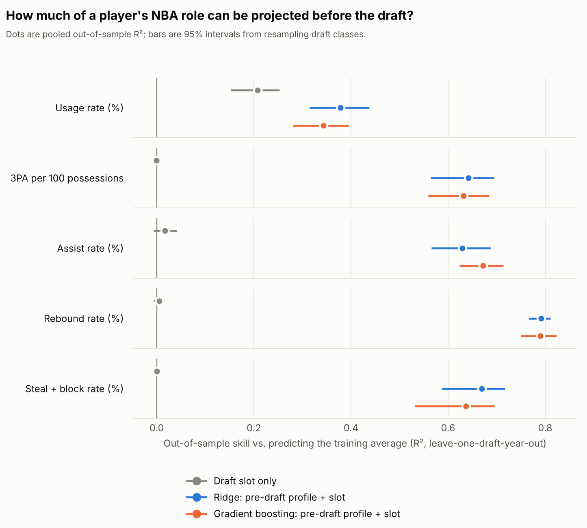
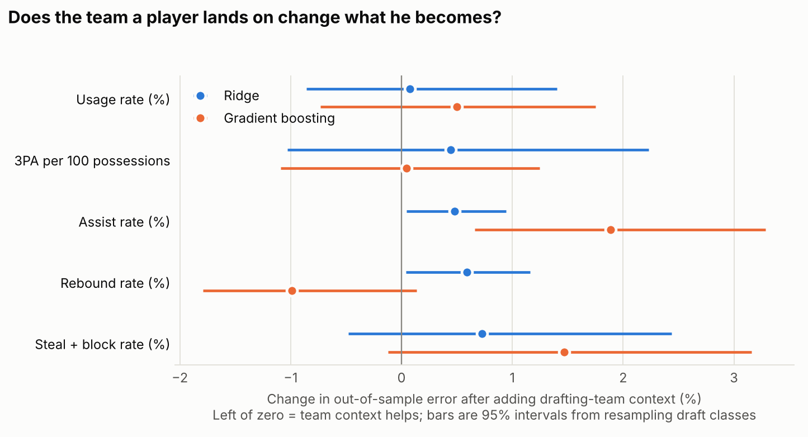
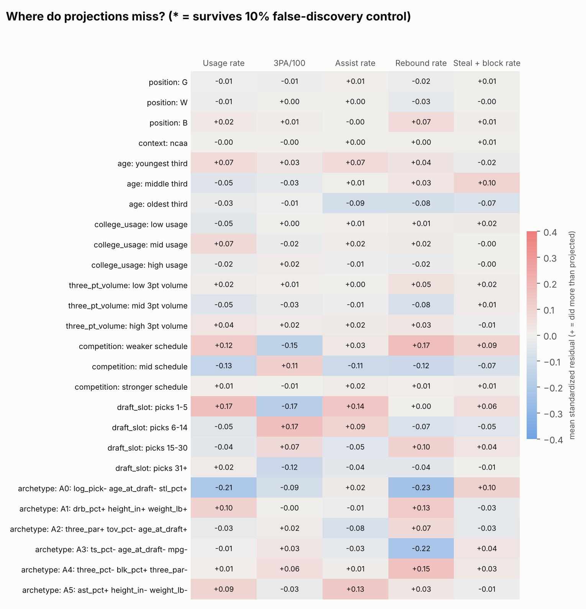

# Projecting NBA roles from pre-draft profiles, and where the projections fail

Most draft models ask "will he be good?" This project asks a narrower question: **given a college
player's pre-draft profile, what role will he play in the NBA** (how much usage he absorbs, how many
threes he takes, how much he passes, rebounds and defends), and **which kinds of players does that
projection get wrong?**

It uses 615 college players from the 2011-2023 NBA drafts, projects five role outcomes averaged over
each player's first three NBA seasons, and tests the projections out of sample, one draft class at a time.

## Summary of findings

| | Finding |
|---|---|
| 1 | A pre-draft college profile projects NBA role well for rebounding, assists, steals+blocks and 3-point volume (out-of-sample R² 0.63 to 0.79) and moderately for usage (0.38). |
| 2 | Most of that skill is **persistence plus position**: a model using only the same college stat and position gets 0.58 to 0.76 on those four outcomes. The full model adds roughly 0.02 to 0.05 there. The clearest gain from the full profile is **usage** (0.38 vs 0.19). |
| 3 | **Draft slot says almost nothing about role** except usage (R² 0.21). It carries no signal for rebounding, 3-point volume, assists or steal+block. |
| 4 | **Landing spot did not help.** Adding the drafting team's prior-season 3-point rate and assist rate did not reduce error for any outcome (it slightly increased it for assist rate). An earlier version showed a ~5% gain on 3-point volume, which turned out to be an artifact of the league-wide rise in 3-point shooting (details below). |
| 5 | **No group of players was systematically mis-projected** after correcting for multiple testing, and a residual tree found no out-of-sample structure. With 13 draft classes this test has little power, so it does not show that the misses are random. |

## Data

All data was exported by hand; nothing was scraped.

| Source | Used for |
|---|---|
| Basketball Reference draft pages, 2010-2023 | pick number, drafting team, college |
| Basketball Reference player index | NBA player ids, weight, first NBA season |
| Basketball Reference league tables, 2011-2026 (Advanced and Per 100 Poss) | NBA outcomes, and drafting-team context |
| Bart Torvik player-season export, 2010-2023 | final-college-season stats, height, birthdate, role label |

The raw exports are included under `data/raw/` exactly as downloaded (draft pages, player index, Torvik
seasons, NBA league tables), and the built tables are in `data/real/`. They come from Basketball
Reference and Bart Torvik, so check each site's terms before reusing or redistributing them.
`python -I scripts/build_real.py` rebuilds `data/real/` from `data/raw/`, and
`data/real/BUILD_REPORT.md` lists the match counts, every unmatched player, and every match that
needed a name fix.

**Sample.** 776 draft picks in 2011-2023. 615 were matched to a Torvik college season. Of those, 477
played at least 500 NBA minutes in their first three seasons and so have a usable role. The other
161 picks were left out: 153 are international or G League players with no college listed, and 8 listed a
college but did not play college ball that season. The 2010 class is excluded because no 2010
team table was exported.

## Method

**Outcomes (five).** Minutes-weighted averages over each player's first three NBA seasons: usage %,
3-point attempts per 100 possessions, assist %, total rebound %, and steal % + block %. A player needs
500+ minutes across those seasons to count as having a role.

**Inputs.** The player's final college season (age at draft, height, weight, minutes share, usage,
true shooting, 3-point rate and %, free-throw rate, assist, turnover, rebound, steal and block rates,
a conference-tier proxy for schedule), position bucket (guard / wing / big, from Torvik's role label),
and log of draft pick.

**Models.** Predicting the training-fold average (reference); draft slot only; ridge regression on the
full profile; gradient boosting (150 shallow trees) on the full profile. Each full-profile model also
has a version that adds drafting-team context.

**Validation.** Leave-one-draft-year-out: train on 12 classes, predict the 13th, repeat. A draft class is
the natural unit of independence, so everything downstream treats classes, not players, as the sample.
Imputation and scaling happen inside each fold. The score is **skill**: out-of-sample R² relative to
predicting the training average.

**Uncertainty.** 95% intervals come from resampling whole draft classes (2,000 draws).

**Team-fit test.** For each outcome, compare error with and without the drafting team's prior-season
3-point rate and assist rate. Team features use the season before the draft only, so nothing from the
player's own NBA years leaks in, and are **measured relative to the league that year** (see
"What went wrong first").

**Where does it fail.** Residuals from the better player-only model are standardized and grouped by
position, age, usage, 3-point volume, conference tier, draft slot and data-driven archetypes (130 group-
by-outcome cells). A Benjamini-Hochberg correction at 10% decides what counts. A shallow decision tree
then tries to predict the residuals from the pre-draft profile, scored out of sample.

**Checks.** The target is shuffled within each draft class and the CV re-run; skill should be about zero.
The pipeline was also built and tested first on generated stand-in data with planted effects, so the
checks were known to find something real when it existed (those outputs live in
`outputs/synthetic_TEST_ONLY/` and are labeled SYNTHETIC).

## Results

### 1. How predictable is role?



Out-of-sample skill (R² vs the training average, 95% interval from resampling draft classes):

| Outcome | Draft slot only | Position + height only | Same college stat + position | Full ridge model |
|---|---|---|---|---|
| Usage | 0.21 (0.15, 0.25) | 0.04 (-0.01, 0.08) | 0.19 (0.13, 0.24) | **0.38** (0.32, 0.44) |
| 3PA per 100 | 0.00 | 0.32 (0.25, 0.39) | 0.61 (0.53, 0.66) | **0.64** (0.56, 0.70) |
| Assist rate | 0.02 (-0.01, 0.04) | 0.38 (0.30, 0.46) | 0.58 (0.51, 0.64) | **0.63** (0.57, 0.69) |
| Rebound rate | 0.01 (-0.01, 0.02) | 0.69 (0.65, 0.73) | 0.76 (0.72, 0.79) | **0.79** (0.77, 0.81) |
| Steal + block rate | 0.00 | 0.35 (0.28, 0.41) | 0.65 (0.59, 0.70) | **0.67** (0.59, 0.72) |

Gradient boosting scored within about 0.05 of ridge on every outcome (slightly better on assist rate,
slightly worse elsewhere), so the full-profile result does not depend on the model choice.

**How to read it.** A player's role in the NBA looks a lot like his role in college, adjusted for
position. That is a real result but not a surprising one: big players who rebounded in college rebound
in the NBA. The full profile's added value is small on four outcomes (the intervals above overlap; I did
not run a paired test) and large on usage, where the full profile and draft slot both carry
information that the college usage number alone does not.

### 2. Does the landing spot matter?



Change in out-of-sample error after adding drafting-team context (negative = team context helps):

| Outcome | Ridge | Gradient boosting |
|---|---|---|
| Usage | +0.1% (-0.9, +1.4) | +0.5% (-0.7, +1.7) |
| 3PA per 100 | +0.4% (-1.0, +2.2) | +0.0% (-1.1, +1.2) |
| Assist rate | +0.5% (+0.0, +0.9) | +1.9% (+0.7, +3.3) |
| Rebound rate | +0.6% (+0.0, +1.2) | -1.0% (-1.8, +0.1) |
| Steal + block rate | +0.7% (-0.5, +2.4) | +1.5% (-0.1, +3.2) |

No outcome shows a clear improvement. For assist rate the extra features made predictions slightly worse,
which is what adding uninformative inputs to a small sample looks like.

### 3. Where do the projections fail?



No group survived the multiple-testing correction, and the residual tree's out-of-sample R² is below
zero for every outcome (-0.09 to -0.18), meaning the misses are not predictable from the profile with
these features. The largest individual misses are readable as player development stories:

- **Took far more threes than projected:** Joel Embiid (2014, pick 3), Devonte' Graham (2018, pick 34),
  Tyrese Martin (2022, pick 51).
- **Took fewer than projected:** Tristan Thompson (2011, pick 4), Brandon Ingram (2016, pick 2),
  Blake Wesley (2022, pick 25).
- **Passed less than projected:** Landry Shamet (2018), Jarrett Culver (2019), Kira Lewis Jr. (2020).

The full list is in `outputs/real/top_misses.csv`. Treat these as case studies, not as evidence of a pattern.

### 4. Leakage check

Shuffling the target within each draft class gives skill of -0.004 (ridge) and -0.008 (boosting), as it should.

## What went wrong first

The first run showed that adding drafting-team context cut error on 3-point volume by about 5%, with an
interval excluding zero (-4.7% ridge, -5.8% boosting). That looked like a team-fit effect. It was not.

Raw team 3-point rate rose from about .22 in 2011 to about .39 in 2023, and so did players' 3-point
volume. With draft year not in the model, team 3-point rate was acting as a stand-in for the calendar.
Measuring each team's rate **relative to the league average that year** removes the effect (+0.4%, interval
-1.0 to +2.2). The pipeline now does this by default. The lesson for the repo: any feature that trends with
time can masquerade as a context effect when the model has no other way to see the year.

## Conclusions

1. For a college prospect, role in the NBA is mostly predictable from role in college plus position.
   A pre-draft scouting profile is worth the most for **usage**, the outcome the same-stat baseline and
   draft slot each capture only half of.
2. Draft slot alone carries almost no information about *role*, except usage. Position and the player's own
   college numbers do the work for the other four outcomes.
3. I found no evidence that where a player is drafted changes his role, using prior-season team 3-point rate
   and assist rate. This is a weak test of "fit" (see limitations), so it supports "no large, simple
   effect", not "no effect".
4. The projection errors that remain look idiosyncratic. The most useful follow-up would be adding
   information the stats cannot see (shooting mechanics, coaching changes, injuries, development
   environment) and testing whether it explains the individual misses above.

## Limitations

- **College players only.** International and G League picks have no college season in these data, so
  the results say nothing about them.
- **Survivor sample.** Outcomes exist only for the 78% of players who reached 500 minutes. Results describe
  players who made the floor. An optional inverse-probability weight (`--ipw`) is included but was not used
  for the numbers above.
- **13 draft classes.** Every interval reflects 13 independent units. The blind residual searches cannot
  detect a narrow group of a few dozen players; test a specific, pre-stated hypothesis with `test_group`
  in `src/residuals.py` instead.
- **Era drift is only partly handled.** League 3-point rates and shot profiles moved a lot over these years.
  Team features are centered by year, but player features and outcomes are not, so the 3-point model
  partly extrapolates for the latest classes.
- **Team context is thin.** Only prior-season team 3-point rate and assist rate. Team pace and roster
  turnover could not be built from the exports and were dropped. "Drafting team" is the team that made
  the pick, not always where the player started.
- **Proxies.** `sos` is a three-level conference-tier proxy, not a schedule-strength rating. Position is
  Torvik's role label (derived from stats). Pre-draft minutes per game is estimated from minutes share.
- **Baselines.** The "same stat + position" model is itself a strong baseline built from the same inputs;
  differences between it and the full model for the four non-usage outcomes were not tested with a paired
  comparison.

## Reproduce

```bash
pip install -r requirements.txt
python -m src.make_synthetic --out data/synthetic   # stand-in data, labeled SYNTHETIC
python run.py --data-dir data/synthetic             # pipeline test
python -m pytest -q

# real data (exports already in data/raw/):
python -I scripts/build_real.py                     # writes data/real/*.csv and BUILD_REPORT.md
python run.py --data-dir data/real                  # ~35 s
python scripts/extra_baselines.py                   # harder baselines (position+height, same stat)
```

## Repository layout

```
run.py                     end-to-end entry point
scripts/build_real.py      raw exports -> data/real/prospects.csv and nba_outcomes.csv (+ match report)
scripts/extra_baselines.py position+height and same-stat baselines
src/config.py              targets, feature groups, thresholds
src/io_utils.py            schema-checked loading
src/features.py           feature sets, draft-year centering of team context
src/models.py              model definitions
src/cv.py                  leave-one-draft-year-out CV, bootstrap, team-fit test, leakage check
src/residuals.py           segments, archetypes, FDR-controlled residual tests
src/plots.py               figures
src/report.py              SUMMARY.md generator
src/make_synthetic.py      generated stand-in data (labeled)
tests/                     pipeline guarantees (no leakage into team features, out-of-fold predictions, ...)
data/README.md             input schema
data/real/BUILD_REPORT.md  match counts and manual-check list
outputs/real/              results: SUMMARY.md, metrics, team fit, residuals, figures
outputs/synthetic_TEST_ONLY/  pipeline test on stand-in data
```
